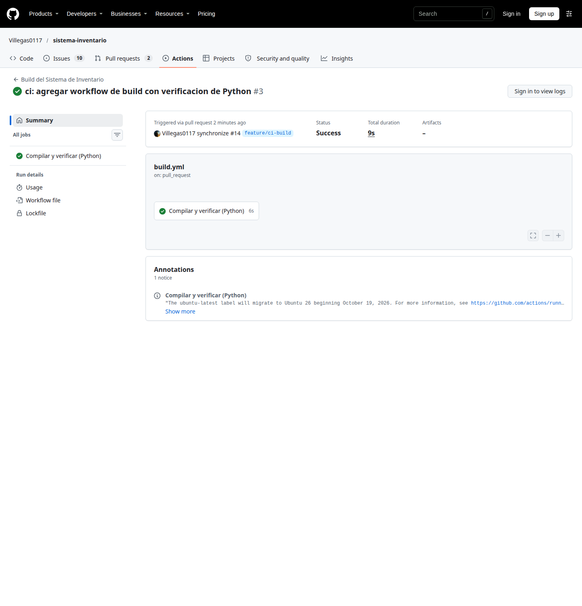
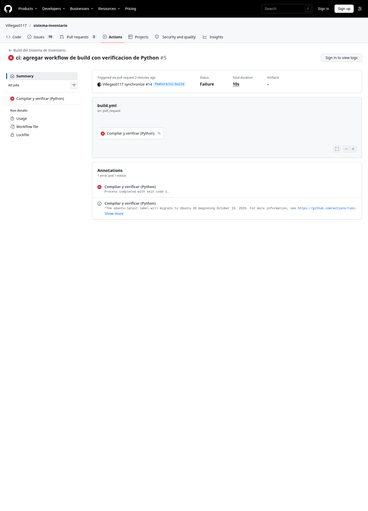

# Práctica: Build — Automatización de la construcción del sistema

**Repositorio:** `Villegas0117/sistema-inventario`
**Herramienta:** GitHub Actions
**Lenguaje del proyecto:** Python 3 (biblioteca estándar, sin dependencias externas)
**Archivo del workflow:** `.github/workflows/build.yml`

---

## Actividad 1. Investigación

### 1. ¿Qué es un workflow en GitHub Actions y para qué sirve?

Un **workflow** es un proceso automatizado que GitHub ejecuta en una máquina virtual (runner) cuando ocurre un evento dentro del repositorio. Se define en un archivo YAML dentro de `.github/workflows/` y está compuesto por uno o más *jobs*, y cada job por una secuencia de *steps*.

Sirve para automatizar tareas de integración y entrega continua (CI/CD): compilar, verificar sintaxis, ejecutar pruebas, analizar calidad del código o desplegar. En esta práctica se usa para comprobar que el sistema de inventario se construye correctamente en cada cambio.

### 2. ¿Qué estructura debe tener un archivo YAML para GitHub Actions?

Los bloques principales son:

| Bloque | Función |
|---|---|
| `name` | Nombre visible del workflow. |
| `on` | Eventos que disparan la ejecución. |
| `permissions` | Permisos del token automático (`GITHUB_TOKEN`). |
| `env` | Variables de entorno (opcional). |
| `jobs` | Conjunto de trabajos. Cada job tiene `runs-on` y `steps`. |
| `steps` | Pasos secuenciales; usan `uses` (acción existente) o `run` (comando de shell). |

### 3. ¿Qué eventos pueden activar automáticamente un workflow?

Entre otros: `push`, `pull_request`, `workflow_dispatch` (manual), `schedule` (cron), `release`, `issues`, `workflow_run`, `repository_dispatch`. Para esta práctica se usan `push`, `pull_request` y `workflow_dispatch`.

### 4. ¿Qué sistema operativo y herramientas necesita el proyecto?

- **Sistema operativo:** Ubuntu (runner `ubuntu-latest`, la opción estándar y gratuita para repositorios públicos).
- **Herramientas:** Git y Python 3. El proyecto solo importa la biblioteca estándar de Python, por lo que no requiere dependencias externas.
- **Versión elegida:** Python 3.12 (versión estable y ampliamente soportada por `setup-python`).

### 5. ¿Cómo se configura el entorno del lenguaje?

Mediante la acción oficial `actions/setup-python`, indicando la versión con `with: python-version`. Si existieran dependencias, se instalarían con `pip install -r requirements.txt`.

### 6. ¿Qué comando permite verificar, compilar o construir el proyecto?

- `python -m compileall -q src`: recorre los archivos `.py`, los compila a bytecode y falla si encuentra errores de sintaxis. Es el equivalente a una verificación de compilación en Python.
- Además se ejecuta una **prueba de humo** que importa `Producto` y comprueba que la clase se instancia correctamente, para verificar que el código no solo compila, sino que funciona.

### 7. ¿Qué archivos de configuración o dependencias necesita el proyecto?

- `.github/workflows/build.yml` (el workflow).
- `src/producto.py` (código fuente).
- No existen `requirements.txt`, `pyproject.toml` ni pruebas automatizadas; por eso el paso de instalación de dependencias es condicional. Si en el futuro se agregan, el workflow ya está preparado.

### 8. ¿Cómo se comprueba si el workflow terminó correctamente o presentó errores?

- En la pestaña **Actions** del repositorio: marca verde (éxito) o roja (fallo) y conclusión de cada job.
- En los **logs** de cada paso se ve el comando ejecutado y el error exacto.
- Desde la terminal con GitHub CLI: `gh run list` y `gh run view <id>`.
- Con reglas de protección de rama, un workflow fallido puede impedir el merge del Pull Request.

### Fuentes consultadas

- GitHub Docs — *About workflows*: https://docs.github.com/en/actions/using-workflows/about-workflows
- GitHub Docs — *Events that trigger workflows*: https://docs.github.com/en/actions/using-workflows/events-that-trigger-workflows
- GitHub Docs — *Workflow syntax for GitHub Actions*: https://docs.github.com/en/actions/writing-workflows/workflow-syntax-for-github-actions
- GitHub Docs — *Building and testing Python*: https://docs.github.com/en/actions/automating-builds-and-tests/building-and-testing-python
- GitHub Docs — *actions/setup-python*: https://github.com/actions/setup-python
- Python Docs — *compileall*: https://docs.python.org/3/library/compileall.html

---

## Actividad 2. Diseño del workflow

| Decisión | Elección | Justificación |
|---|---|---|
| Nombre | `Build del Sistema de Inventario` | Identifica claramente la función. |
| Eventos | `push`, `pull_request`, `workflow_dispatch` | Se valida en cada cambio, antes de integrar y de forma manual si hace falta. |
| Ramas | `main` y `feature/**`; PR hacia `main` | Cubre la rama principal y las ramas de trabajo del equipo. |
| Entorno | `ubuntu-latest` | Runner estándar, rápido y gratuito para repos públicos. |
| Lenguaje | Python 3.12 con `actions/setup-python` | Versión estable y reproducible. |
| Dependencias | Instalación condicional si existe `requirements.txt` | El proyecto actual no tiene dependencias externas. |
| Verificación | `python -m compileall -q src` | Detecta errores de sintaxis (fallo de compilación). |
| Prueba funcional | Prueba de humo que instancia `Producto` | Confirma que el código compilado funciona. |
| Permisos | `contents: read` | Principio de mínimo privilegio. |

---

## Explicación del archivo `build.yml`

```yaml
name: Build del Sistema de Inventario
```
Nombre del workflow tal como aparece en la pestaña Actions.

```yaml
on:
  push:
    branches:
      - main
      - "feature/**"
  pull_request:
    branches:
      - main
  workflow_dispatch:
```
- `push` en `main` y en cualquier rama `feature/*`: valida cada cambio subido.
- `pull_request` hacia `main`: valida el código antes de integrarlo.
- `workflow_dispatch`: permite ejecutarlo manualmente desde GitHub.

```yaml
permissions:
  contents: read
```
El workflow solo lee el repositorio; no necesita permisos de escritura.

```yaml
jobs:
  build:
    name: Compilar y verificar (Python)
    runs-on: ubuntu-latest
```
Define el job `build`, su nombre visible y la máquina virtual donde se ejecuta.

```yaml
    steps:
      - name: Descargar el código
        uses: actions/checkout@v7
```
Descarga el contenido del repositorio en el runner (sin este paso no hay código que compilar).

```yaml
      - name: Configurar Python
        uses: actions/setup-python@v7
        with:
          python-version: "3.12"
```
Instala y deja activa la versión de Python indicada.

```yaml
      - name: Instalar dependencias
        run: |
          if [ -f requirements.txt ]; then
            python -m pip install -r requirements.txt
          else
            echo "No hay requirements.txt: el proyecto solo usa la biblioteca estándar."
          fi
```
Instala dependencias solo si el proyecto las declara. Hoy no existen, por lo que el paso informa y continúa.

```yaml
      - name: Verificar sintaxis y compilar
        run: python -m compileall -q src
```
Compila todos los módulos de `src/`. Si hay un error de sintaxis, el comando devuelve código de salida distinto de cero y el workflow falla.

```yaml
      - name: Ejecutar prueba de humo
        run: |
          python - <<'PY'
          from src.producto import Producto

          producto = Producto("A001", "Teclado", 250.0, 10)
          assert producto.codigo == "A001"
          assert producto.nombre == "Teclado"
          assert producto.precio == 250.0
          assert producto.existencia == 10
          print("Prueba de humo correcta: el proyecto se construye y funciona.")
          PY
```
Verifica que la clase `Producto` se importe y se instancie con los valores esperados. Así no solo se comprueba la sintaxis, sino también un comportamiento básico.

---

## Actividad 3 y 4. Implementación, prueba y evidencias

### Bitácora de ejecuciones

Pull Request: **#14** — https://github.com/Villegas0117/sistema-inventario/pull/14

| # | Commit | Acción | Resultado | Enlace a la ejecución |
|---|---|---|---|---|
| 1 | `d48bf42` | Se agrega el workflow | ✅ Éxito | https://github.com/Villegas0117/sistema-inventario/actions/runs/42951710344 |
| 2 | `f46c5b8` | Se actualizan `checkout` y `setup-python` a v7 | ✅ Éxito | https://github.com/Villegas0117/sistema-inventario/actions/runs/42951823088 |
| 3 | `d7b2b25` | Se introduce un error de sintaxis | ❌ Fallo | https://github.com/Villegas0117/sistema-inventario/actions/runs/42951908889 |
| 4 | `62583e3` | Se corrige el error | ✅ Éxito | https://github.com/Villegas0117/sistema-inventario/actions/runs/42951975978 |


### Evidencias (capturas)

Las capturas están incluidas en `docs/evidencias/`:

1. `01-ejecucion-exitosa.png` — resumen de la ejecución en verde.
2. `02-ejecucion-fallida.png` — ejecución en rojo con la anotación de error.
3. `03-ejecucion-corregida.png` — nueva ejecución en verde tras la corrección.






> Nota: en un repositorio público, el resumen y la conclusión de cada ejecución son visibles sin iniciar sesión, pero los logs detallados piden autenticarse. Para la entrega puedes añadir una captura extra del log del paso **Verificar sintaxis y compilar** con el `SyntaxError` estando autenticado en GitHub.

### Error provocado

Se eliminó intencionalmente el `:` de la línea 10 de `src/producto.py`, dejando `def mostrar_informacion(self)`:

```text
*** Error compiling 'src/producto.py'...
  File "src/producto.py", line 10
    def mostrar_informacion(self)
                                 ^
SyntaxError: expected ':'
```

El workflow falló en el paso **Verificar sintaxis y compilar** (commit `d7b2b25`) y se detuvo antes de la prueba de humo. Después se restauró el `:` en el commit `62583e3`; la siguiente ejecución terminó correctamente en verde.

---

## Reflexión

**1. ¿Qué problema evita la automatización?**
Evita que cambios que no compilan o que rompen el proyecto se integren sin que nadie lo note. Sin automatización, cada integrante confía en que “en su máquina funciona”; con Actions, todo cambio se valida en un entorno limpio y reproducible antes de llegar a `main`.

**2. ¿Qué diferencia existe entre ejecutar el proyecto manualmente y utilizar GitHub Actions?**
La ejecución manual depende de que alguien se acuerde de hacerla, puede variar según el entorno de cada computadora y no deja un registro común. GitHub Actions se ejecuta siempre ante los mismos eventos, en un entorno estandarizado, deja evidencia pública de cada resultado y puede bloquear la integración si falla.

**3. ¿Qué ocurrió cuando introdujeron un error?**
El workflow se disparó automáticamente con el push, falló en el paso de compilación con un `SyntaxError`, GitHub marcó la ejecución en rojo y el job se detuvo antes de la prueba de humo. Eso permitió identificar de inmediato el commit y la línea responsable.

**4. ¿Por qué es conveniente detectar el error inmediatamente?**
Porque el error se aísla en el cambio que lo produjo, se corrige cuando el contexto aún está fresco y no se propaga a los demás integrantes ni a la rama principal. Detectar tarde un fallo obliga a revisar muchos commits y puede bloquear el trabajo del equipo.
